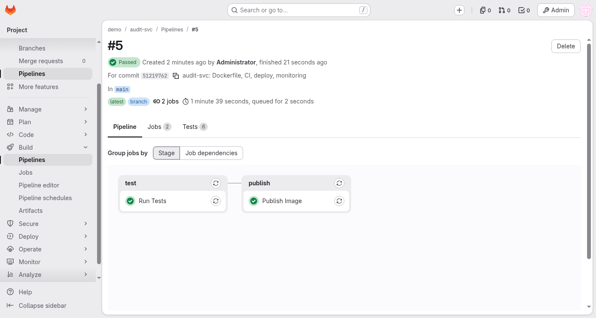
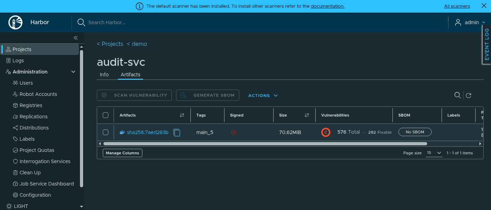
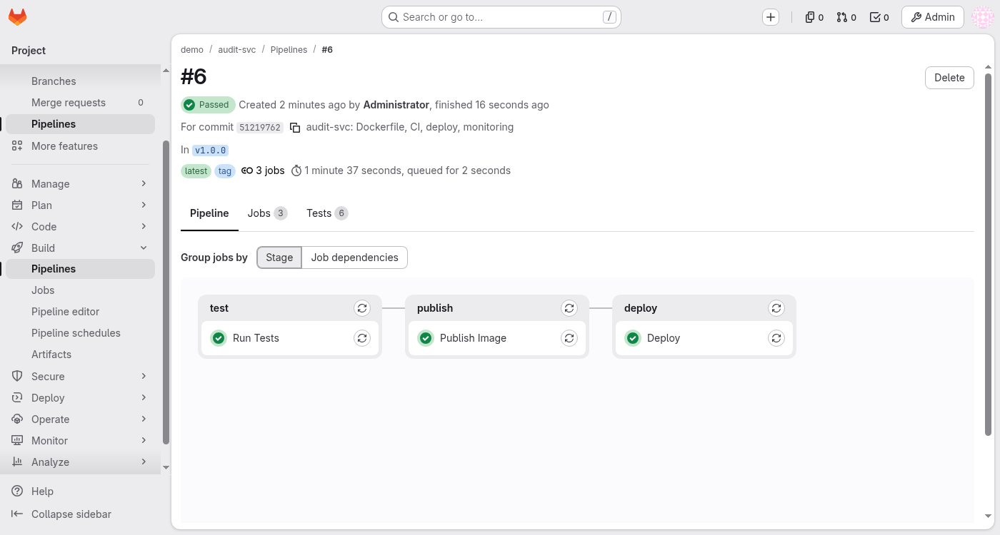
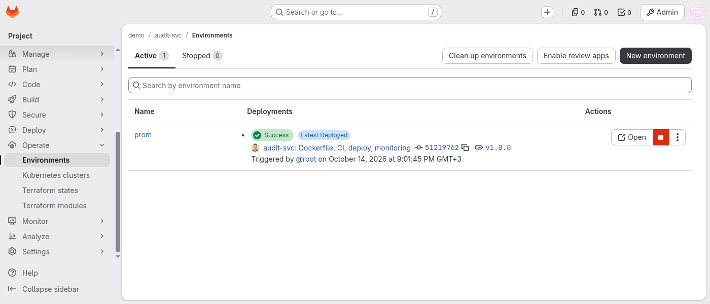
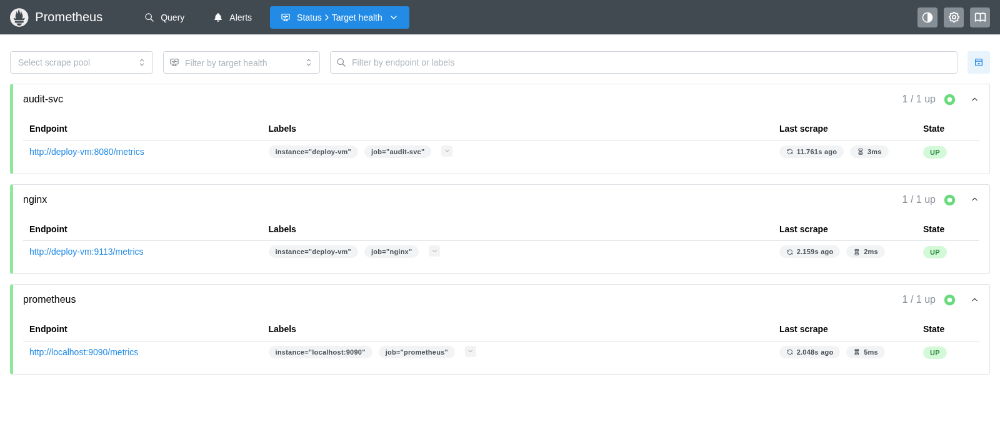
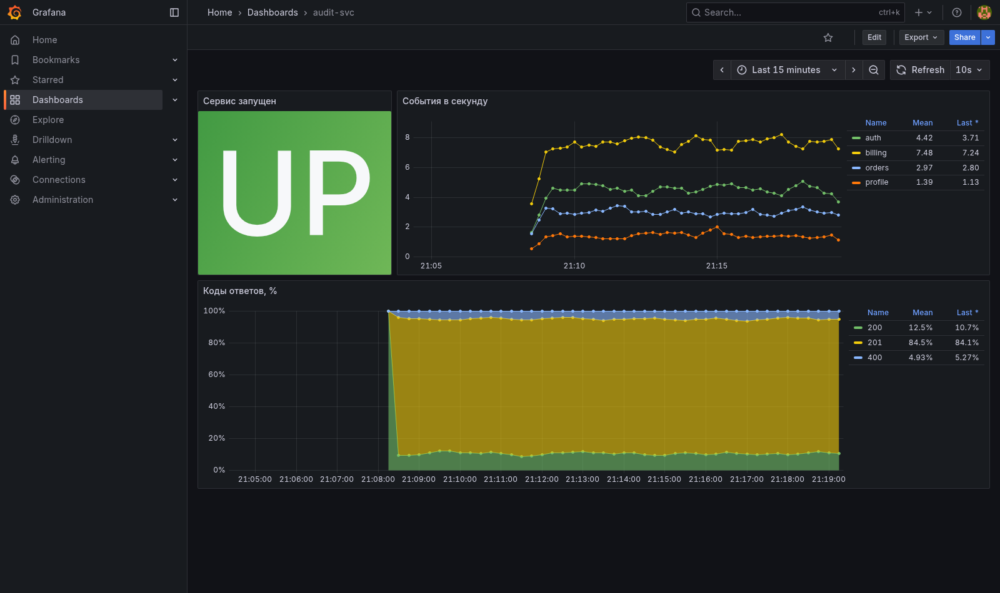
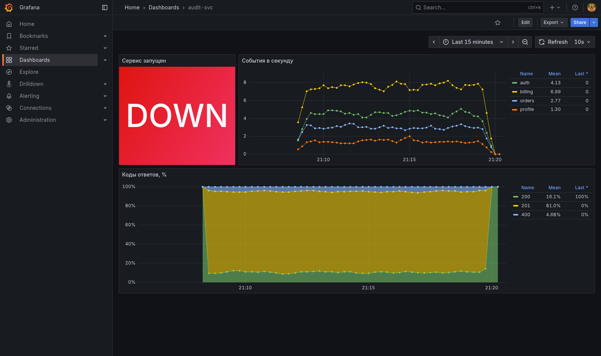
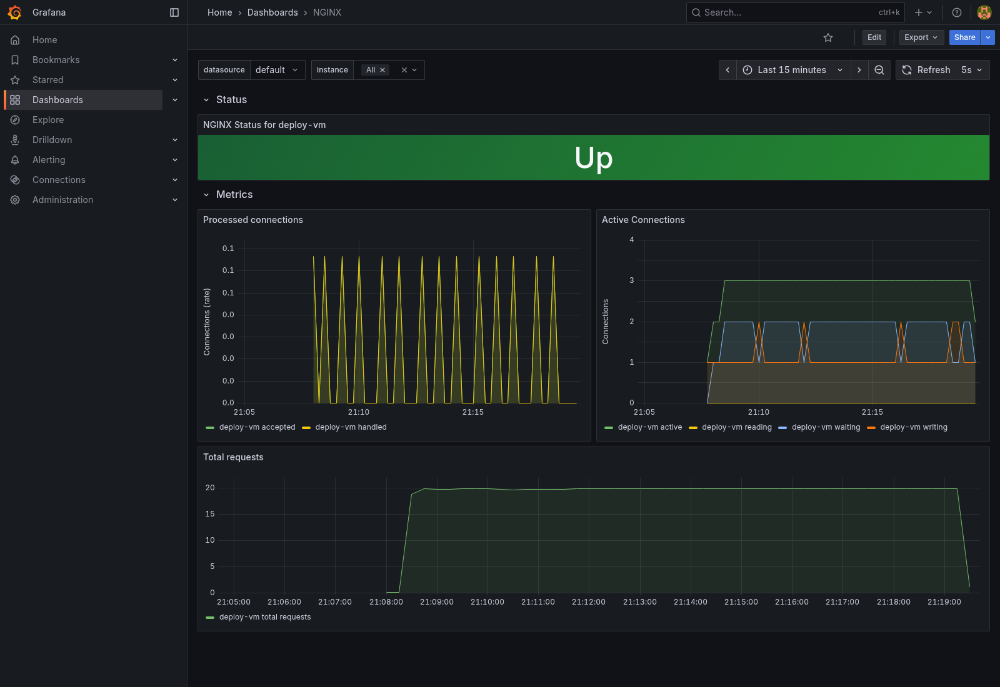

# Отчёт: итоговая работа audit-svc

Пащенко Дмитрий

Рабочая история коммитов и теги релизов (`v1.0.0`, `v1.0.1`, `v1.1.0`) из отчёта пушились в локальный GitLab стенда (`gitlab.localtest.me`), а на GitHub выложено итоговое состояние репозитория одним коммитом без тегов.

| Задание | Где реализовано |
|---|---|
| 1. Сборка и публикация | `Dockerfile`, `.dockerignore`, `.gitlab-ci.yml` |
| 2. БД и секреты | `deploy/inventories/prom/group_vars/all/vault.yml`, `deploy/vault-pass.sh` |
| 3. Развёртывание и reload | `deploy/audit-svc.play.yml`, `deploy/templates/` |
| 4. Nginx и exporter | `deploy/templates/nginx.conf.j2` |
| 5. Мониторинг | `monitoring/` |
| Доп. задание: миграции | задача `Run database migrations` в плейбуке |

## 1. Пайплайн ветки main



Тесты (JUnit):

```
{"id":5,"ref":"main","status":"success"}
{"time":0.041,"count":6,"success":6,"failed":0,"skipped":0,"error":0,"suite_error":null}
```

Лог публикации образа в Harbor:

```
$ set -eu
$ b64_auth=$(printf '%s:%s' "$HARBOR_ROBOT_USER" "$HARBOR_ROBOT_SECRET" | base64 | tr -d '\n')
$ printf '{"auths": {"%s": {"auth": "%s"}}}' "$HARBOR_HOST" "$b64_auth" >/kaniko/.docker/config.json
$ /kaniko/executor --reproducible --context "$CI_PROJECT_DIR" --dockerfile "$CI_PROJECT_DIR/Dockerfile" --destination "$HARBOR_IMAGE:$IMAGE_TAG" --digest-file image.digest
INFO[0040] Pushing image to harbor.localtest.me:8443/demo/audit-svc:main_51219762 
INFO[0041] Pushed harbor.localtest.me:8443/demo/audit-svc@sha256:7aed263bc47c13890305567db577547e46d8cbf319ab6d1b193b526f43882a36 
$ echo "pushed $HARBOR_IMAGE:$IMAGE_TAG@$(cat image.digest)"
pushed harbor.localtest.me:8443/demo/audit-svc:main_51219762@sha256:7aed263bc47c13890305567db577547e46d8cbf319ab6d1b193b526f43882a36
Job succeeded
секрет робота в логе: 0
```



## 2. Пайплайн защищённого тега v1.0.0

Настройка защищённых тегов `v*` и CI-переменных с флагами `Masked` и `Protected` приведена в ноутбуке `final_Пащенко_Дмитрий.ipynb` (`In [7]` и `In [9]`):

```
{"name": "v*", "create_access_levels": ["Maintainers"]}
{"key": "ANSIBLE_VAULT_PASSWORD", "masked": true, "protected": true, "raw": true}
HARBOR_ROBOT_USER    masked=false protected=false
HARBOR_ROBOT_SECRET  masked=true  protected=true
DEPLOY_TOKEN         masked=true  protected=true
```





<details><summary>Полный лог задачи Deploy (v1.0.0)</summary>

```
pipeline 6, job 5
Running with gitlab-runner 19.4.1 (3c39fceb)
  on deploy-vm SUiDYAsz9, system ID: r_5uvncVYfI01P
  UUID: 01a13b8e-cc17-75f4-b89f-874282658b4e
section_start:1792000868:prepare_executor
Preparing the "shell" executor
Using Shell (bash) executor...
section_end:1792000868:prepare_executor
section_start:1792000868:prepare_script
Preparing environment
Running on deploy-vm...
section_end:1792000868:prepare_script
section_start:1792000868:get_sources
Getting source from Git repository
Gitaly correlation ID: 01M4XS6G097XG20PJ5QVW1TE8Y
Fetching changes with git depth set to 20...
Initialized empty Git repository in /data/gitlab-runner/builds/SUiDYAsz9/0/demo/audit-svc/.git/
Created fresh repository.
Checking out 51219762 as detached HEAD (ref is v1.0.0)...
Skipping Git submodules setup
section_end:1792000868:get_sources
section_start:1792000868:download_artifacts
Downloading artifacts
Downloading artifacts for Publish Image (4)...
Runtime platform                                    arch=amd64 os=linux pid=1255 revision=3c39fceb version=19.4.1
Downloading artifacts from coordinator... ok        correlation_id=01M4XS6GQ16Z4J8E5YH6H8F2NC id=4 status=200 token=eyJraWQiO
section_end:1792000869:download_artifacts
section_start:1792000869:step_script
Executing "step_script" stage of the job script
$ set -eu
$ printf '%s' "$HARBOR_ROBOT_SECRET" | docker login --username "$HARBOR_ROBOT_USER" --password-stdin "$HARBOR_HOST"
Login Succeeded

WARNING! Your credentials are stored unencrypted in '/home/gitlab-runner/.docker/config.json'.
Configure a credential helper to remove this warning. See
https://docs.docker.com/go/credential-store/

$ cd deploy
$ ansible-playbook audit-svc.play.yml --vault-password-file ./vault-pass.sh --extra-vars "audit_svc__image=$HARBOR_IMAGE:$IMAGE_TAG"

PLAY [Deploy audit-svc] ********************************************************

TASK [Gathering Facts] *********************************************************
ok: [deploy-vm]

TASK [Check that image is set] *************************************************
ok: [deploy-vm] => {
    "changed": false,
    "msg": "All assertions passed"
}

TASK [Create docker network] ***************************************************
changed: [deploy-vm]

TASK [Create postgres volume] **************************************************
changed: [deploy-vm]

TASK [Create config directories] ***********************************************
changed: [deploy-vm] => (item=/data/audit-svc/config)
changed: [deploy-vm] => (item=/data/audit-svc/nginx)

TASK [Start PostgreSQL] ********************************************************
changed: [deploy-vm]
FAILED - RETRYING: [deploy-vm]: Wait for PostgreSQL to become healthy (30 retries left).
FAILED - RETRYING: [deploy-vm]: Wait for PostgreSQL to become healthy (29 retries left).
FAILED - RETRYING: [deploy-vm]: Wait for PostgreSQL to become healthy (28 retries left).

TASK [Wait for PostgreSQL to become healthy] ***********************************
ok: [deploy-vm]

TASK [Remember PostgreSQL address] *********************************************
ok: [deploy-vm]

TASK [Create database user] ****************************************************
changed: [deploy-vm]

TASK [Create database] *********************************************************
changed: [deploy-vm]

TASK [Render audit-svc config] *************************************************
changed: [deploy-vm]

TASK [Pull audit-svc image] ****************************************************
changed: [deploy-vm]

TASK [Run database migrations] *************************************************
changed: [deploy-vm]

TASK [Show migration log] ******************************************************
ok: [deploy-vm] => {
    "__migrate.stderr_lines": [
        "[INFO] applying 0001_create_events",
        "[INFO] applying 0002_events_app_index",
        "[INFO] done: 2 applied, 0 already in place"
    ]
}

TASK [Start audit-svc] *********************************************************
changed: [deploy-vm]

TASK [Render nginx config] *****************************************************
changed: [deploy-vm]

TASK [Start nginx] *************************************************************
changed: [deploy-vm]

TASK [Start nginx-exporter] ****************************************************
changed: [deploy-vm]

RUNNING HANDLER [Get audit-svc address] ****************************************
ok: [deploy-vm]

RUNNING HANDLER [POST /reload] *************************************************
changed: [deploy-vm]

RUNNING HANDLER [Show /reload response] ****************************************
ok: [deploy-vm] => {
    "__reload.json": {
        "changed": false,
        "status": "reloaded"
    }
}

RUNNING HANDLER [Reload nginx] *************************************************
changed: [deploy-vm]

TASK [Check /healthz through nginx] ********************************************
ok: [deploy-vm]

TASK [Check nginx-exporter] ****************************************************
ok: [deploy-vm]

PLAY RECAP *********************************************************************
deploy-vm                  : ok=24   changed=15   unreachable=0    failed=0    skipped=0    rescued=0    ignored=0   

section_end:1792000905:step_script
section_start:1792000905:cleanup_file_variables
Cleaning up project directory and file based variables
section_end:1792000905:cleanup_file_variables
Job succeeded
```
</details>

Проверка скрытия паролей в логе задачи:

```
vault_postgres_superuser_password: 0
vault_audit_svc_db_password: 0
vault password: 0
```

Повторный запуск Deploy (проверка идемпотентности, `changed=0`):

```
retry: job 5 -> job 6
TASK [Gathering Facts] *********************************************************
TASK [Check that image is set] *************************************************
TASK [Create docker network] ***************************************************
TASK [Create postgres volume] **************************************************
TASK [Create config directories] ***********************************************
TASK [Start PostgreSQL] ********************************************************
TASK [Wait for PostgreSQL to become healthy] ***********************************
TASK [Remember PostgreSQL address] *********************************************
TASK [Create database user] ****************************************************
TASK [Create database] *********************************************************
TASK [Render audit-svc config] *************************************************
TASK [Pull audit-svc image] ****************************************************
TASK [Run database migrations] *************************************************
TASK [Show migration log] ******************************************************
TASK [Start audit-svc] *********************************************************
TASK [Render nginx config] *****************************************************
TASK [Start nginx] *************************************************************
TASK [Start nginx-exporter] ****************************************************
TASK [Check /healthz through nginx] ********************************************
TASK [Check nginx-exporter] ****************************************************
PLAY RECAP *********************************************************************
deploy-vm                  : ok=20   changed=0    unreachable=0    failed=0    skipped=0    rescued=0    ignored=0   
StartedAt до:    2026-10-14T18:01:34.125872917Z
StartedAt после: 2026-10-14T18:01:34.125872917Z
```

## 3. Смена пароля без перезапуска сервиса

1. Зафиксировал время старта контейнера и счётчик reload перед сменой пароля:

```
2026-10-14T18:01:34.125872917Z
audit_config_reloads_total{result="success"} 1.0
```

2. Обновил пароль базы в `vault.yml` и выпустил тег `v1.0.1`:

```
96d87f73cb0343e5fc67c3aca444acab  inventories/prom/group_vars/all/vault.yml
9f2eb77eee637888ddcd584fa58de896  inventories/prom/group_vars/all/vault.yml
To http://gitlab.localtest.me:8929/demo/audit-svc.git
   5121976..1f9c01c  main -> main
To http://gitlab.localtest.me:8929/demo/audit-svc.git
 * [new tag]         v1.0.1 -> v1.0.1
==> audit-svc: пайплайн #8 — success (http://gitlab.localtest.me:8929/demo/audit-svc/-/pipelines/8)
  success   test  Run Tests  (46 s)
  success   publish  Publish Image  (46 s)
  success   deploy  Deploy  (8 s)
```

3. Лог деплоя с новым паролем. Видно, что изменился пароль в базе и перегенерировался конфиг, после чего сработал хендлер reload, а сам сервис не перезапускался (для этого в kaniko и Dockerfile зафиксирована воспроизводимость сборки, иначе при новом теге менялся бы digest и контейнер перезапускался):

```
pipeline 8, job 11
TASK [Gathering Facts] *********************************************************
ok: [deploy-vm]
TASK [Check that image is set] *************************************************
ok: [deploy-vm] => {
    "changed": false,
TASK [Create docker network] ***************************************************
ok: [deploy-vm]
TASK [Create postgres volume] **************************************************
ok: [deploy-vm]
TASK [Create config directories] ***********************************************
ok: [deploy-vm] => (item=/data/audit-svc/config)
ok: [deploy-vm] => (item=/data/audit-svc/nginx)
TASK [Start PostgreSQL] ********************************************************
ok: [deploy-vm]
TASK [Wait for PostgreSQL to become healthy] ***********************************
ok: [deploy-vm]
TASK [Remember PostgreSQL address] *********************************************
ok: [deploy-vm]
TASK [Create database user] ****************************************************
changed: [deploy-vm]
TASK [Create database] *********************************************************
ok: [deploy-vm]
TASK [Render audit-svc config] *************************************************
changed: [deploy-vm]
TASK [Pull audit-svc image] ****************************************************
changed: [deploy-vm]
TASK [Run database migrations] *************************************************
ok: [deploy-vm]
TASK [Show migration log] ******************************************************
ok: [deploy-vm] => {
        "[INFO] done: 0 applied, 2 already in place"
TASK [Start audit-svc] *********************************************************
ok: [deploy-vm]
TASK [Render nginx config] *****************************************************
ok: [deploy-vm]
TASK [Start nginx] *************************************************************
ok: [deploy-vm]
TASK [Start nginx-exporter] ****************************************************
ok: [deploy-vm]
RUNNING HANDLER [Get audit-svc address] ****************************************
ok: [deploy-vm]
RUNNING HANDLER [POST /reload] *************************************************
changed: [deploy-vm]
RUNNING HANDLER [Show /reload response] ****************************************
ok: [deploy-vm] => {
        "changed": true,
        "status": "reloaded"
TASK [Check /healthz through nginx] ********************************************
ok: [deploy-vm]
TASK [Check nginx-exporter] ****************************************************
ok: [deploy-vm]
PLAY RECAP *********************************************************************
deploy-vm                  : ok=23   changed=4    unreachable=0    failed=0    skipped=0    rescued=0    ignored=0
```

4. Проверка после деплоя: время запуска контейнера не изменилось, в логах сервиса появилось сообщение о перечитывании конфига, счётчик `audit_config_reloads_total` увеличился, `/healthz` отдаёт 200:

```
StartedAt до:    2026-10-14T18:01:34.125872917Z
StartedAt после: 2026-10-14T18:01:34.125872917Z
2026-10-14 18:01:44,450 [INFO] audit_svc.main: config reloaded, database settings are unchanged
2026-10-14 18:05:06,029 [INFO] audit_svc.main: config reloaded, reconnected to the database
audit_config_reloads_total{result="success"} 2.0
{"status": "ok"}  -> 200
{"id": 2}
{"digest":"sha256:7aed263bc47c","tags":["v1.0.1","main_1f9c01cb","v1.0.0","main_51219762"]}
```

## 4. Проверки Nginx

Проверка фильтрации путей: `/healthz` и `/api/` работают, а `/reload` и произвольные запросы возвращают 404 (включая обходы через %72eload и //reload - nginx нормализует путь перед проверкой location, поэтому запрос отсекается до сервиса). Порты наружу открыты только для nginx (8080) и nginx-exporter (9113):

```
'config reload' в логе сервиса до: 1
$ curl -s localhost:8088/healthz
{"status": "ok"}
$ curl -s -o /dev/null -w '%{http_code}\n' -X POST localhost:8088/reload
404
$ curl -s -o /dev/null -w '%{http_code}\n' -X POST 'localhost:8088/reload?x=1'
404
$ curl -s -o /dev/null -w '%{http_code}\n' -X POST localhost:8088//reload
404
$ curl -s -o /dev/null -w '%{http_code}\n' -X POST localhost:8088/%72eload
404
'config reload' после: 1
$ docker exec deploy-vm docker ps --format '{{.Names}}\t{{.Ports}}'
audit-nginx-exporter	0.0.0.0:9113->9113/tcp
audit-nginx	80/tcp, 0.0.0.0:8080->8080/tcp
audit-svc	8080/tcp
audit-postgres	5432/tcp
```

```
$ curl -s -o /dev/null -w 'localhost:8088/stub_status -> %{http_code}\n' localhost:8088/stub_status
localhost:8088/stub_status -> 404
$ docker exec deploy-vm docker exec audit-nginx wget -qO- http://127.0.0.1:8081/stub_status
Active connections: 2 
server accepts handled requests
 14 14 14 
Reading: 0 Writing: 1 Waiting: 1 
$ docker exec deploy-vm curl -s localhost:9113/metrics | grep -E '^nginx_up'
nginx_up 1
```

## 5. Мониторинг

Оба таргета (`audit-svc` и `nginx`) в статусе UP:



Генератор нагрузки отработал 11 минут:

```
sent 12601: {'200': 1286, '201': 10691, '400': 624}
sent 12798: {'200': 1307, '201': 10858, '400': 633}
total 12974: {'200': 1329, '201': 11004, '400': 641}
генератор закончил: 18:19:04 UTC
```

Дашборд сервиса (`monitoring/grafana/audit-svc.json`). Панель "Сервис запущен" показывает UP:



Остановил контейнер сервиса (`docker stop audit-svc`) для проверки панели статуса - переключился в DOWN:

```
audit-svc
audit-svc	down	server returned HTTP status 502 Bad Gateway
```



Дашборд Nginx (`monitoring/grafana/nginx.json`):



## 6. Дополнительное задание: миграция при развёртывании

Добавил миграцию `0003_events_actor_index.sql` и запустил развёртывание с тегом `v1.1.0`. В логе видно, что миграция применилась до запуска сервиса:

```
pipeline 10, job 16
TASK [Gathering Facts] *********************************************************
ok: [deploy-vm]
TASK [Check that image is set] *************************************************
ok: [deploy-vm] => {
TASK [Create docker network] ***************************************************
ok: [deploy-vm]
TASK [Create postgres volume] **************************************************
ok: [deploy-vm]
TASK [Create config directories] ***********************************************
ok: [deploy-vm] => (item=/data/audit-svc/config)
ok: [deploy-vm] => (item=/data/audit-svc/nginx)
TASK [Start PostgreSQL] ********************************************************
ok: [deploy-vm]
TASK [Wait for PostgreSQL to become healthy] ***********************************
ok: [deploy-vm]
TASK [Remember PostgreSQL address] *********************************************
ok: [deploy-vm]
TASK [Create database user] ****************************************************
ok: [deploy-vm]
TASK [Create database] *********************************************************
ok: [deploy-vm]
TASK [Render audit-svc config] *************************************************
ok: [deploy-vm]
TASK [Pull audit-svc image] ****************************************************
changed: [deploy-vm]
TASK [Run database migrations] *************************************************
changed: [deploy-vm]
TASK [Show migration log] ******************************************************
ok: [deploy-vm] => {
        "[INFO] applying 0003_events_actor_index",
        "[INFO] done: 1 applied, 2 already in place"
TASK [Start audit-svc] *********************************************************
changed: [deploy-vm]
TASK [Render nginx config] *****************************************************
ok: [deploy-vm]
TASK [Start nginx] *************************************************************
ok: [deploy-vm]
TASK [Start nginx-exporter] ****************************************************
ok: [deploy-vm]
TASK [Check /healthz through nginx] ********************************************
ok: [deploy-vm]
TASK [Check nginx-exporter] ****************************************************
ok: [deploy-vm]
PLAY RECAP *********************************************************************
deploy-vm                  : ok=20   changed=3    unreachable=0    failed=0    skipped=0    rescued=0    ignored=0
```
